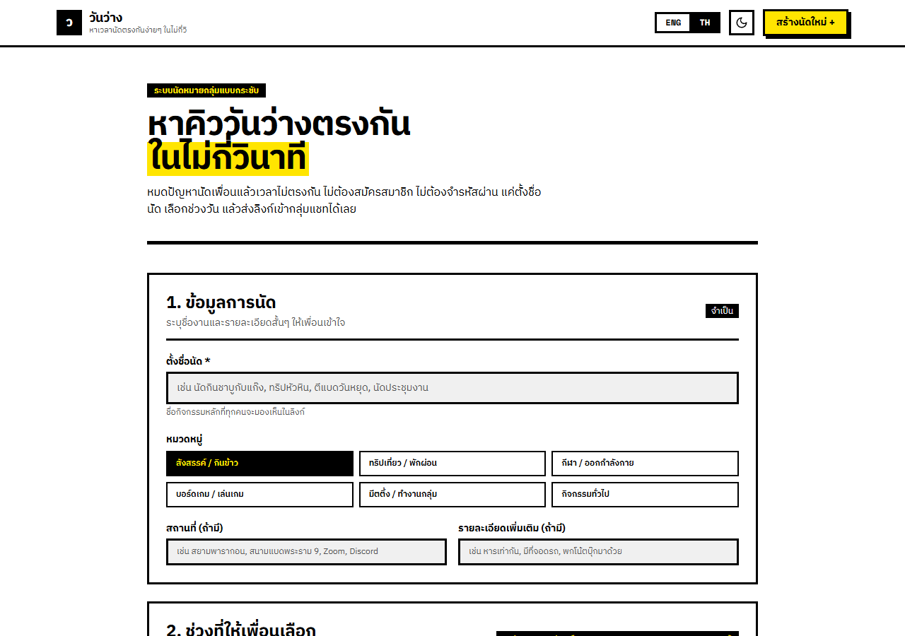
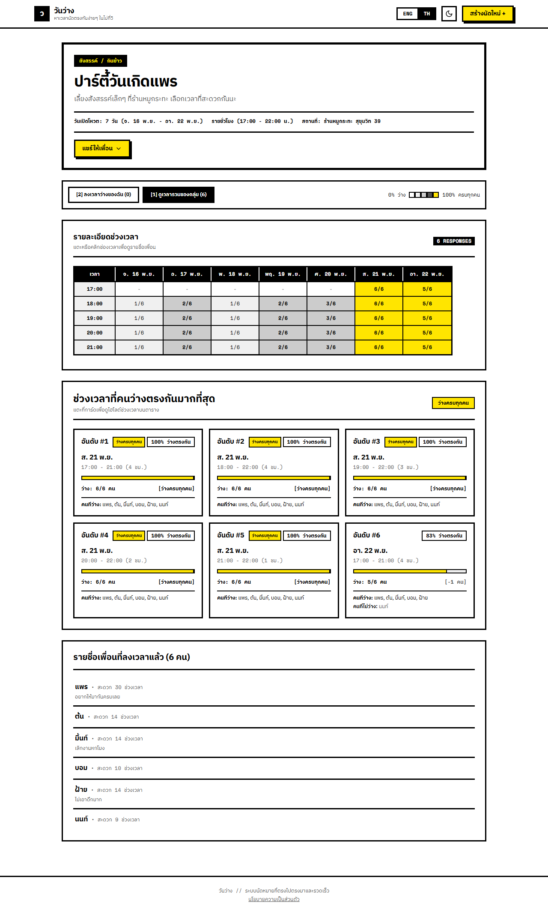
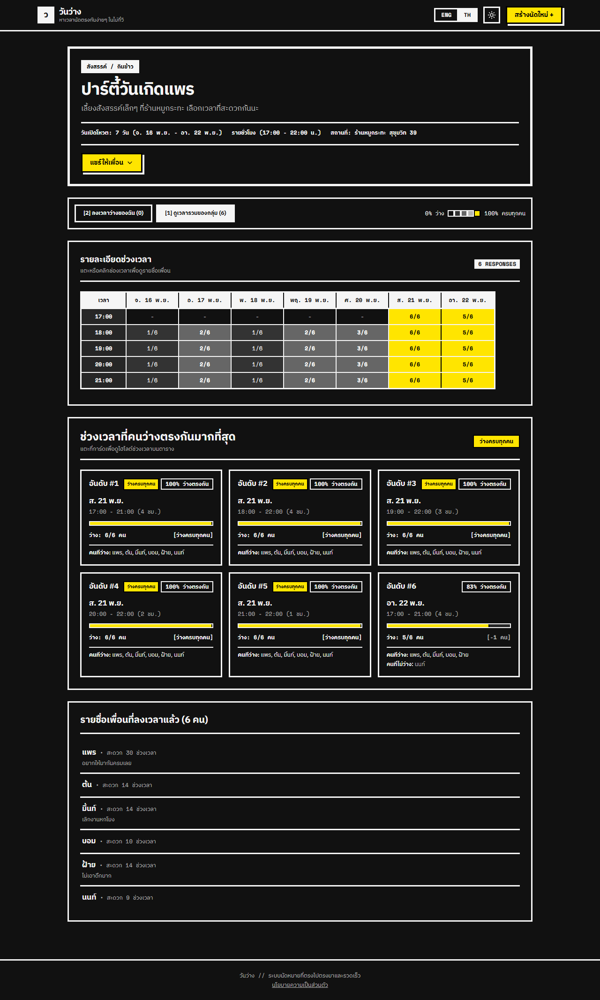
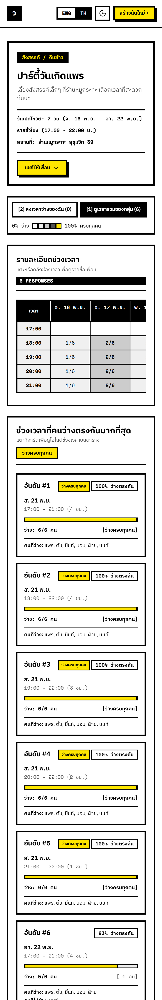

# วันว่าง (WanWang)

เว็บโพลหาเวลานัดที่ทุกคนว่างตรงกัน ไม่ต้องสมัครสมาชิก ตั้งชื่อนัด เลือกช่วงวัน แล้วส่งลิงก์เข้ากลุ่มแชทได้เลย

**เว็บ live:** https://wanwang-one.vercel.app

> **English:** WanWang ("free day") is a sign-up-free scheduling poll. Create an event, share the link in a group chat, and everyone marks the times they are free; a heatmap and ranked best times show when the group overlaps. Thai/English UI, light/dark theme, all-day / day-part / hourly formats. Includes a native Android/iOS app that shares the same API.

## ตัวอย่างหน้าจอ

ข้อมูลในภาพเป็นข้อมูลสมมติ

| หน้าสร้างนัด | หน้าผลลัพธ์ของกลุ่ม |
|---|---|
|  |  |

| ธีมมืด | มือถือ |
|---|---|
|  |  |

## เทคโนโลยี

- **เว็บ:** Next.js 15 (App Router), React 19, TypeScript, Tailwind CSS
- **ฐานข้อมูล:** Supabase (Postgres) เข้าถึงผ่าน API route ด้วย service role เท่านั้น, pg_cron ลบข้อมูลที่หมดอายุ
- **แอปมือถือ:** Expo SDK 58 / React Native 0.88 ใน [`mobile/`](mobile/) เรียก API เดียวกับเว็บ และใช้โค้ดคำนวณร่วมกันจาก `src/lib` (Reanimated, Gesture Handler, Expo Router, deep link `/e/<slug>`)
- **คุณภาพ:** Vitest, ESLint, GitHub Actions CI, Content Security Policy แบบ nonce, rate limit ด้วย IP hash
- **Deploy:** Vercel (Singapore) + Supabase

## ฟีเจอร์

**สร้างนัด**
- เลือกหมวดหมู่ได้ 6 แบบ: สังสรรค์, ทริป, กีฬา, บอร์ดเกม, มีตติ้ง, ทั่วไป
- เลือกช่วงวันเองหรือใช้ทางลัด 2 สัปดาห์, 1 เดือน, 2 เดือน, 1 ปี (สูงสุด 366 วัน)
- เลือกความละเอียดได้ 3 แบบ: ทั้งวัน, ช่วงของวัน, รายชั่วโมง

**ลงเวลา**
- เปิดลิงก์ กรอกชื่อ แล้วแตะหรือลากเลือกเวลาที่ว่าง
- มีทางลัดเลือกเสาร์-อาทิตย์ทั้งหมด, เลือกทั้งหมด และล้างทั้งหมด
- แก้หรือลบคำตอบของตัวเองได้จากเบราว์เซอร์เดิม

**ดูผล**
- Heatmap แสดงว่าช่วงไหนมีคนว่างมากแค่ไหน และแตะดูชื่อคนได้
- จัดอันดับเวลาที่คนว่างตรงกันมากที่สุด พร้อมรายชื่อคนที่ว่างและคนที่ติดธุระ

**แชร์**
- แชร์ผ่านหน้าต่างแชร์ของระบบ, LINE หรือ WhatsApp
- คัดลอกลิงก์หรือข้อความสรุปได้
- ลิงก์ที่แชร์แสดงชื่อนัดในตัวอย่างลิงก์ของแอปแชท

**ผู้สร้างนัด**
- ได้ลิงก์แอดมินสำหรับปิดหรือเปิดรับคำตอบ, ยืนยันวันนัด และลบคำตอบหรือลบนัด
- เปลี่ยนลิงก์แอดมินใหม่ได้ ลิงก์เก่าจะใช้ไม่ได้ทันที

เว็บรองรับภาษาไทยและอังกฤษ และมีธีมสว่างกับธีมมืดที่ตามการตั้งค่าของเครื่องหรือสลับเองได้

## รันในเครื่อง

ต้องใช้ Node.js 24 (เวอร์ชันเดียวกับ CI)

```bash
npm install
cp .env.example .env.local   # ไม่บังคับ ดูด้านล่าง
npm run dev
```

เปิด [http://localhost:3000](http://localhost:3000)

ถ้าไม่ตั้งค่า Supabase ตอน dev แอปจะเก็บข้อมูลในไฟล์ `data/*.json` แทน โหมดนี้ใช้กับ production ไม่ได้ เพราะแอปจะ error ทันทีเมื่อไม่มีฐานข้อมูล

| คำสั่ง | ใช้ทำอะไร |
|---|---|
| `npm run dev` | รัน dev server |
| `npm run lint` | ตรวจด้วย ESLint |
| `npm test` | รันเทสต์ด้วย Vitest ไม่ต้องใช้ฐานข้อมูล |
| `npm run build` | build production และตรวจ lint กับ type (ต้องต่อเน็ตเพื่อโหลดฟอนต์) |

อย่ารัน `npm run build` ระหว่างที่ `npm run dev` เปิดอยู่ เพราะใช้โฟลเดอร์ `.next` ร่วมกัน

CI ใน [`.github/workflows/ci.yml`](.github/workflows/ci.yml) รัน lint, test และ build ทุก pull request และทุกครั้งที่ push เข้า `main`

## ฐานข้อมูล

Schema อยู่ที่ [`supabase/schema.sql`](supabase/schema.sql) รันซ้ำได้ และอัปเกรดจาก schema เก่าให้เอง

แอปเข้าถึงฐานข้อมูลผ่าน API route ด้วย `service_role` key เท่านั้น ส่วน role `anon` และ `authenticated` ถูกตัดสิทธิ์ที่ตาราง

**การลบข้อมูล:** job `wanwang-cleanup` ใน pg_cron รันทุกวันเวลา 03:00 UTC และลบนัดพร้อมคำตอบ 90 วันหลังวันสุดท้ายของนัด หรือ 90 วันหลังวันที่สร้าง แล้วแต่ว่าวันใดมาทีหลัง ถ้าจะเปลี่ยนระยะเวลา ต้องแก้ทั้ง `purge_expired_events()`, `src/lib/privacyContent.ts` และ `createVisibilityNote` ใน `src/lib/translations.ts` ซึ่งมีเทสต์ตรวจว่าตรงกัน

## สถิติสำหรับเจ้าของ

ฐานข้อมูลนับยอดรวมรายวันไว้ในตาราง `stats_daily` (จำนวนนัด คำตอบ ไฟล์แนบ ความคิดเห็น) ด้วย trigger เป็นตัวเลขอย่างเดียว ไม่มีชื่อหรือเนื้อหา และคงอยู่หลังนัดถูกลบตามรอบ 90 วัน

ดูรายงานได้จากเครื่องตัวเองเท่านั้น เว็บไม่มีหน้าที่อ่านตารางนี้:

```bash
node scripts/owner-stats.mjs --open
```

สร้างไฟล์ `.env.stats.local` ก่อน โดยใส่ `SUPABASE_URL` และ `SUPABASE_SERVICE_ROLE_KEY` ของโปรเจกต์ production (ไฟล์นี้ไม่ถูก commit) คำสั่งจะพิมพ์ยอดรวมและเขียนรายงานพร้อมกราฟไว้ที่ `data/owner-stats.html`

## ความปลอดภัยและความเป็นส่วนตัว

- เก็บ admin key และ edit token เฉพาะค่า SHA-256
- จำกัดจำนวนคำขอต่อ IP โดยเก็บเฉพาะค่า hash ของ IP
- ใช้ Content Security Policy แบบ nonce
- โหลดฟอนต์จากเว็บตัวเอง ผู้ใช้จึงไม่ต้องเชื่อมต่อกับ Google
- หน้า `/e/*` ส่ง `X-Robots-Tag: noindex` เพราะแสดงชื่อคน
- นโยบายความเป็นส่วนตัวอยู่ที่ `/privacy` ถ้าพฤติกรรมของแอปเปลี่ยน ต้องแก้ข้อความใน `src/lib/privacyContent.ts` ให้ตรงกัน

## Deploy บน Vercel + Supabase

**1. เตรียม Supabase**
1. สร้างโปรเจกต์ที่ [supabase.com](https://supabase.com)
2. รัน `supabase/schema.sql` ใน SQL Editor
3. ตรวจว่ามี job ลบข้อมูล โดยควรได้ `wanwang-cleanup`, `0 3 * * *`, `true`
   ```sql
   select jobname, schedule, active from cron.job;
   ```
   ถ้าไม่มี แปลว่าข้อมูลจะไม่ถูกลบ และ `/privacy` จะไม่ตรงกับความจริง

**2. ตั้งค่า Vercel**

Import repo นี้ แล้วตั้ง Environment Variables ดังนี้

| ตัวแปร | ค่า | หมายเหตุ |
|---|---|---|
| `SUPABASE_URL` | Project URL | |
| `SUPABASE_SERVICE_ROLE_KEY` | `service_role` key | เป็นความลับ ห้ามเติม `NEXT_PUBLIC_` และห้าม commit |
| `NEXT_PUBLIC_SITE_URL` | เช่น `https://your-domain.vercel.app` | ใช้สร้าง URL ของรูปตัวอย่างลิงก์ |
| `NEXT_PUBLIC_PRIVACY_CONTACT` | อีเมลติดต่อ | ถ้าไม่ตั้ง `/privacy` จะไม่มีส่วนติดต่อ |

ตัวแปรที่ขึ้นต้นด้วย `NEXT_PUBLIC_` ถูกฝังตอน build ถ้าเปลี่ยนค่าต้อง deploy ใหม่

**3. ตรวจหลัง deploy**
- สร้างนัด ลงเวลา และลบนัดได้
- ส่งลิงก์เข้าแอปแชทจริงแล้วเห็นชื่อนัดกับรูปตัวอย่าง
- กดปุ่มแชร์และคัดลอกได้บนมือถือจริง

## ไลเซนส์

[MIT](LICENSE)
